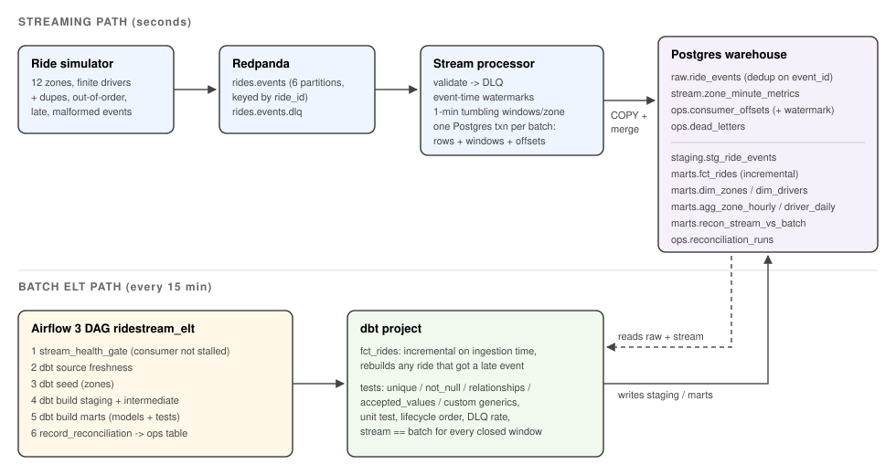

# data-platform

[](https://github.com/Samarateja0118/data-platform/actions/workflows/ci.yml)

A small but complete data platform for a simulated ride-hailing marketplace.
One warehouse, two paths into it:

* **Streaming**: ride events flow through Redpanda into a Python stream processor
  that computes 1-minute event-time windows per zone and commits each event to
  Postgres about 130 ms (p50; p99 under 240 ms) after it was produced.
* **Batch ELT**: an Airflow 3 DAG runs dbt every 15 minutes to build ride facts,
  dimensions and hourly marts from the same landing table, tests them, and
  checks that the streaming numbers match a batch recount.

Everything runs with `make demo` on a laptop (Docker Compose), and every number
below was measured with the scripts in this repo.

**At a glance:** 525,722 messages consumed while the consumer was `SIGKILL`ed five times mid-stream, and the warehouse still matched exactly (519,489 unique valid events, 1,017 dead letters, window sums equal to raw). Batching the sink took throughput from 339 to about 25,800 msg/s. Details in the sections below.



## Why it is built this way

| Problem | What the code does |
|---|---|
| Kafka delivers at least once, and producers retry | The consumer inserts into `raw.ride_events` with `ON CONFLICT (event_id) DO NOTHING` and only folds the **rows that were actually inserted** into the window table, all in one SQL statement. Replays and duplicates cannot double count. |
| A crash between "write data" and "commit offset" | Offsets and per-partition watermarks are stored in `ops.consumer_offsets` **in the same Postgres transaction** as the data. On restart the consumer seeks to what Postgres says, not what Kafka says. |
| Events arrive out of order | Windows use event time. Each partition's watermark is `max(event_time) - 30s`; the global watermark is the minimum over **all** partitions, so a partition that has not been read yet holds windows open instead of letting them close early. |
| Some events arrive minutes late | An event whose window already closed is still stored in raw (flagged `is_late`) but not added to the streaming aggregate. The batch layer counts it. `fct_rides` is incremental on *ingestion* time, so a ride that gets a late event is rebuilt from all of its events, no matter how late. |
| Bad payloads | Strict contract in `schema.py`. Failures go to `ops.dead_letters` and the `rides.events.dlq` topic with the reason; the stream keeps flowing. A dbt test fails the build if dead letters pass 1%. |
| "Is the stream right?" | `recon_stream_vs_batch` recomputes every closed window from raw. The `assert_stream_matches_batch` test requires an exact match (counts and fare cents) and `assert_reconciliation_not_vacuous` stops it from passing by comparing nothing. Airflow records every check in `ops.reconciliation_runs`. |

The simulator (`generator.py`) is a seeded discrete-event model: 12 zones with
different demand, a finite driver pool, a one-hour demand wave that causes
`no_driver` cancellations at peak, and a fault injector that adds 1% duplicates,
3% out-of-order events (inside the allowed lateness), 0.4% late events (past it)
and 0.2% malformed payloads. Same seed, same stream, which is what lets the
tests check exact counts.

## Quick start

```bash
make demo            # build, start, stream live for 3 min, run the DAG, print a report
```

Requirements: Docker with Compose v2, about 4 GB of free RAM. Other targets:

```bash
make up / make down  # start / stop (down -v drops the data)
make elt             # trigger the Airflow DAG now (it also runs every 15 min)
make report          # stream health, latency, latest windows, reconciliation history
make test            # unit tests (no Docker needed)
make integration     # end-to-end tests against Redpanda + Postgres
make bench           # throughput sweep, crash test, latency
```

Airflow UI is at http://localhost:8080 (user `admin`; the password is printed by
`docker compose exec airflow cat /opt/airflow/simple_auth_manager_passwords.json.generated`).

## Measured results

Environment: a 4 vCPU / 15 GB cloud container, single-node Redpanda 24.2
(`--smp 1`), Postgres 16, one consumer process. Raw output is in
[`results/bench.jsonl`](results/bench.jsonl); the producer manifests (ground
truth counts) are next to it.

### Consumer throughput vs batch size

`python scripts/bench.py throughput`: 60 simulated minutes at 10 rides/s
(124,789 messages, 6 partitions) published first, then consumed from scratch.
Each run gets its own topic and database.

| Batch size | Messages | Consume time | Throughput | Exact? |
|---:|---:|---:|---:|:--:|
| 1 (a transaction per message) | 8,612 | 25.4 s | **339 msg/s** | yes |
| 100 | 124,789 | 9.5 s | 13,090 msg/s | yes |
| 500 | 124,789 | 5.8 s | 21,487 msg/s | yes |
| 2,000 (default) | 124,789 | 4.8 s | **25,796 msg/s** | yes |
| 5,000 | 124,789 | 4.6 s | 27,227 msg/s | yes |

"Exact" means rows in raw equal the manifest's unique valid events and dead
letters equal the injected malformed count. Batching the Postgres write
(COPY into a temp table, one merge statement, one commit) is worth about 76x
over committing per message. Past 2,000 the gain flattens; the producer
itself publishes at about 28-30k msg/s here, so the consumer is close to the
rate it can be fed on this box.

### Crash recovery

`python scripts/bench.py chaos`: 525,722 messages (240 simulated minutes,
5,216 injected duplicates, 1,017 malformed), consumed with batch size 200
while the consumer was killed with `SIGKILL` five times, about 14 s after each
start (all five landed mid-stream; a fresh consumer then finished the job).

| Check | Expected | Got |
|---|---:|---:|
| Unique valid events in raw | 519,489 | 519,489 |
| Dead letters | 1,017 | 1,017 |
| Sum of streaming window counts = on-time raw events | 518,996 | 518,996 |
| Streaming fare total = batch on-time fare total (cents) | 149,928,220 | 149,928,220 |

No loss, no double counting, after five hard kills. CI repeats a smaller
version (3 kills) on every push.

### End-to-end latency

`python scripts/bench.py latency` measures `ingested_at - kafka_ts` for every
event in a 5-minute window of the live stack (time from the producer handing
the message to Kafka until the row is committed in Postgres).

| Live load | Events in window | p50 | p95 | p99 | max |
|---|---:|---:|---:|---:|---:|
| 50 rides/s (~83 events/s) | 24,105 | 127 ms | 219 ms | 228 ms | 277 ms |
| 400 rides/s (~1,029 events/s) | 185,183 | 136 ms | 231 ms | 239 ms | 310 ms |

Latency barely moves with a 12x increase in load.

The floor is set by configuration, not work: `linger.ms=20` on the producer
and `fetch.wait.max.ms=100` on the consumer. Lowering them trades CPU and
request count for latency.

### Batch layer

* dbt: 8 models, 1 seed, 25 data tests, 1 unit test. A full `dbt build` on the
  30-minute backfill takes about 1.4 s; an incremental Airflow run is about 20 s
  end to end, most of it task start-up.
* A clean `make demo` (5 min of live data, [`results/demo-report.txt`](results/demo-report.txt))
  finished with the DAG green and 60 of 60 closed windows reconciled exactly.
  A longer 15-minute live run reconciled 202 of 202. Rides take ~17 minutes
  end to end, so a short demo shows few completions; leave it running (the DAG
  re-runs every 15 minutes) to see the marts fill in.
* Late data in practice: in that 15-minute live run, 42 events arrived after
  their window closed. The stream left them out on purpose, the batch marts
  include them, and the reconciliation explains the difference.

### Bugs the end-to-end runs caught

**1. Missing dbt dependency.** 
The first full demo failed on the *second* DAG run. `fct_rides` only
references `stg_ride_events` inside its `is_incremental()` filter, so dbt
did not record the dependency, and `dbt build --select marts` failed once the
table existed. The first run passed because it was a full build. The fix is
the `-- depends_on:` hint at the top of the model, and the integration test
now runs dbt twice. This is the kind of thing only shows up when the
scheduler runs the pipeline repeatedly, which is why the demo does.

**2. Reused ids after a producer restart.** After several live producer runs,
`assert_lifecycle_order` and the `non_negative` tests on `wait_s` failed on
113 rides. The simulator numbered rides `r00000001...` and derived event ids
from the seed, so every restarted producer reused ride ids (mixing different
rides into one), and a restart with the *same* seed would have reused event
ids, which the dedupe step would have silently dropped as duplicates. Live
runs now namespace ride and event ids with a random run id; backfills keep a
seed-derived namespace so they stay reproducible. A unit test covers it. The
data tests did their job: `dbt build` skipped every model downstream of the
failing `fct_rides` tests (dimensions, hourly and driver marts) and the DAG
went red, so the bad rows never reached the reporting tables.

## Repository layout

```
src/ridestream/        schema.py (contract), generator.py (simulator + faults),
                       producer.py, consumer.py, windows.py (watermarks), sink.py (txn)
sql/init.sql           raw / stream / ops schemas
dbt/ridestream/        staging, intermediate, marts, tests, seeds, unit test
airflow/dags/          ridestream_elt (Airflow 3 TaskFlow + BashOperator)
scripts/               demo.sh, bench.py, report.sql
tests/unit             schema, windows, generator (29 tests)
tests/integration      producer -> Redpanda -> consumer -> Postgres -> dbt (4 tests)
tests/dag              DAG integrity
.github/workflows      lint, unit, integration + benchmarks, DAG, compose/image build
```

## Honest limits

* **Simulated data.** The marketplace is a model with made-up rates, not real traffic.
* **One machine.** Single-node Redpanda with replication factor 1, one Postgres,
  one consumer process. The throughput numbers are for catch-up reads with the
  producer already finished, on 4 vCPUs. They show the cost of each design
  choice, not production capacity.
* **Exactly-once covers the Postgres sink only.** The DLQ topic is at-least-once.
* **Idle partitions stall windows.** Because the global watermark waits for every
  partition, a partition that stops receiving data stops windows from closing.
  Flink solves this with idle-source timeouts; this code does not.
* **Late detection depends on read skew.** When the consumer replays a backlog,
  partitions are read at different speeds, so the global watermark lags and
  fewer events are flagged late (493 flagged vs 2,099 injected-late in the
  crash test). Results stay exact, because what the stream skips the batch
  counts, but the late count is a property of the run, not the data.
* **Postgres is both the sink and the warehouse.** Fine at this size, wrong at
  real scale (see below).
* **JSON with a hand-written contract**, no schema registry.
* **Airflow runs `standalone`** (scheduler, API server and DAG processor in one
  container). Not highly available.

## What I'd do at scale

* **Storage split.** Land raw events in object storage as Iceberg or Delta tables
  (Kafka Connect or Redpanda's Iceberg topics) and serve marts from a columnar
  warehouse (Snowflake, BigQuery or ClickHouse). Keep Postgres for the small,
  hot, transactional pieces.
* **Stream processing engine.** Move windows to Flink (or Kafka Streams) for
  managed state, idle-partition handling, and checkpointed exactly-once, with
  the same "dedupe, then aggregate only what was inserted" rule at the sink.
  The current design already scales out by partition: offsets and watermarks
  are per partition, so more consumers in the group just take more partitions.
* **Contracts.** Avro or Protobuf with a schema registry and compatibility checks
  in CI, so a producer cannot ship a breaking change.
* **Orchestration.** Airflow on Kubernetes (KubernetesExecutor) or Dagster with
  asset-based scheduling; dbt runs in its own image per task; data tests gate
  publishing with blue/green schemas so consumers never see a half-built mart.
* **Observability.** Consumer lag, watermark delay, DLQ rate and reconciliation
  drift exported to Prometheus with alerts, instead of log lines and an ops table.
* **Backfills and replays.** DLQ replay tooling, and partitioned
  `fct_rides` by day so a backfill rewrites days, not the whole table.
